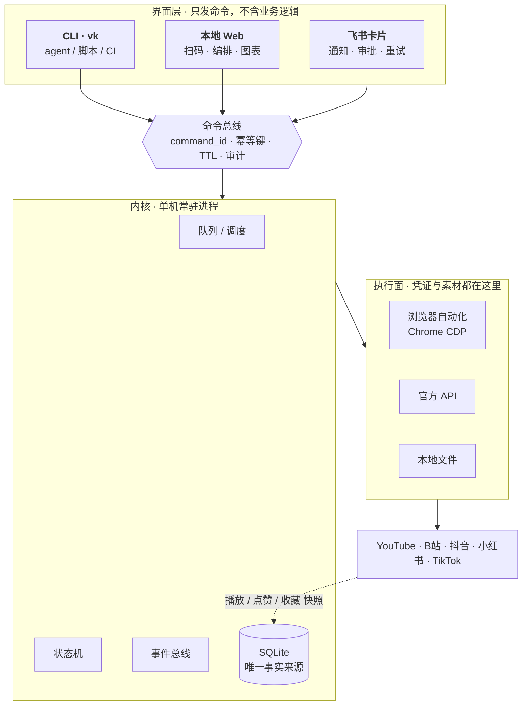
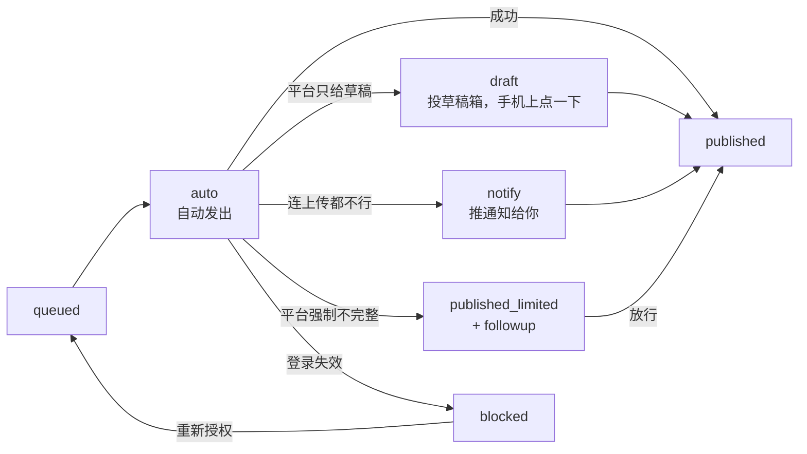

<p align="center">
  <b>makerset</b> · 给创作者的开源工具集
</p>

<h1 align="center">versekit</h1>

<p align="center">
  跑在你电脑上的<strong>多平台发布 + 自有账号数据</strong>控制面<br/>
  <sub>电脑干活（凭证、发布、采集）· 手机拍板（通知、审批、重试）</sub>
</p>

<p align="center">
  <a href="docs/PRD.md">PRD</a> ·
  <a href="docs/ARCHITECTURE.md">架构</a> ·
  <a href="docs/platforms.md">平台矩阵</a> ·
  <a href="docs/adapter-contract.md">适配器规约</a> ·
  <a href="docs/wireframes.html">设计稿</a>
</p>

---

## 它解决什么

一条内容发 6 个平台要 40 分钟；发完不知道效果；登录态天天过期，人在外面就卡住。

现有产品分两类，两类都缺一半：**SaaS**（Buffer / Postiz Cloud / 蚁小二）手机体验好，但**凭证在别人手里**；**自托管开源**（Mixpost / Postiz 自部署）数据在自己手里，但**没有手机控制面**。

versekit 的位置只有一个：

> **凭证在你手里，同时手机上能拍板。**

---

## 怎么工作



**三条铁律**（进 CI）：CLI 能力完整（没有"只有网页能做"的事）· 三端语义一致 · Web 与飞书不得直接读写数据库。

---

## 发布模式

默认 `auto`，走不通才降级 —— **人只在该被叫醒时被叫醒**。



**永不静默失败**：每次发布必须终结在 `published / published_limited / 草稿待发 / notify待确认 / failed(带原因)` 之一，且记 `fallback_reason`。

---

## 状态

**v0.1 走骨架**：文档齐全；CLI 有 `init / doctor / now / commands`；**平台适配器尚未接入**。

| 层 | 状态 |
|---|---|
| 文档（PRD / 架构 / 平台矩阵 / 适配器规约 / 设计稿） | ✅ |
| 内核（schema · 状态机 · 事件去重 · 幂等队列 · 命令注册表） | ✅ |
| **队列 runner**（租约/心跳/退避重试/单账号串行） | ✅ 20/20 测试通过 |
| Chrome CDP 驱动（持久 profile · 真实鼠标 · shadow DOM · 响应拦截） | ✅ |
| CLI `vk init / now / doctor / commands / serve` | ✅ |
| 适配器：YouTube · B站 · TikTok · 小红书 · 抖音 | ⬜ v0.1–v0.2 |
| 飞书通道（长连接 + 交互卡片） | ⬜ v0.2 |
| 本地 Web（5 页） | ⬜ v0.2 |

---

## 快速开始

```bash
node -v                  # 需要 ≥ 22.5（用到 node:sqlite）
npm run vk -- init       # 建库 + 配置
npm run vk -- doctor --human
npm run vk -- now --human
npm test
```

状态目录（`VK_HOME` 可改）：

```
~/.config/versekit/        config.json · credentials/
~/.local/state/versekit/   vk.db · vk.log · browser/（Chrome profile）
```

---

## 平台

| 平台 | 路线 | 资质 | 状态 |
|---|---|---|---|
| YouTube | 官方 Data API v3 | 不需要 | 设计完成，待实现 |
| B站 | biliup + 自己的 cookie | 不需要 | 设计完成，待实现 |
| TikTok | TikTok Studio 网页自动化 | **不需要** | 设计完成，待实现 |
| 小红书 | 创作服务平台网页自动化 | **不需要** | 设计完成，待实现 |
| 抖音 | 创作者中心网页自动化 | **不需要** | Wave 2 |

详见 [`docs/platforms.md`](docs/platforms.md)。

---

## 合规边界

只自动化**你自己已登录的会话**（扫码得到的 cookie / Chrome profile）：不逆向签名、不采集公开内容、不碰别人的账号。

这条边界是开源能站住的前提，也是上表"零资质"的原因 —— 平台授权的是**用户你自己**，不是我们的应用。

---

## 仓库

```
packages/
  core/              schema.sql · 状态机 · 事件 · 队列 · 命令注册表 · test/
  driver-browser/    持久 Chrome CDP 驱动（三平台共用）
  cli/               vk
docs/
  PRD.md             产品定义 · 范围 · 竞品位置 · 路线图
  ARCHITECTURE.md    进程形态 · schema · 命令表 · 事件 · 采集器 · CI 契约
  platforms.md       五平台能力矩阵（自动化 / 资质 / 降级率）
  adapter-contract.md 适配器规约：接口 + 14 条硬规则 + 反模式
  adr-0001-reuse.md  复用裁决：只借知识，少抄代码
  wireframes.html    7 屏设计稿（浏览器打开）
```

---

<p align="center"><sub>MIT · makerset</sub></p>
