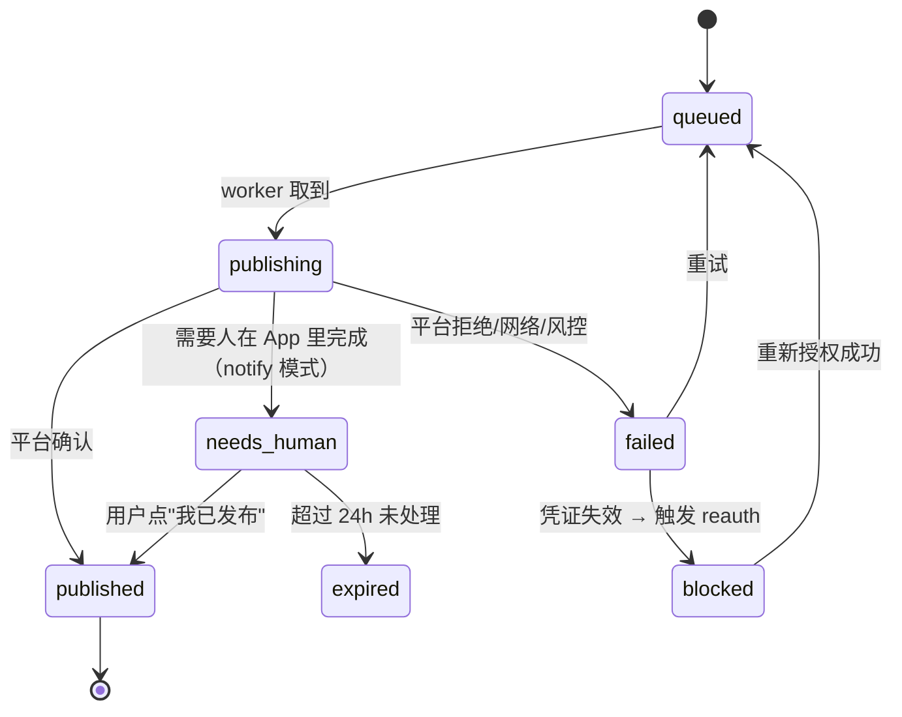
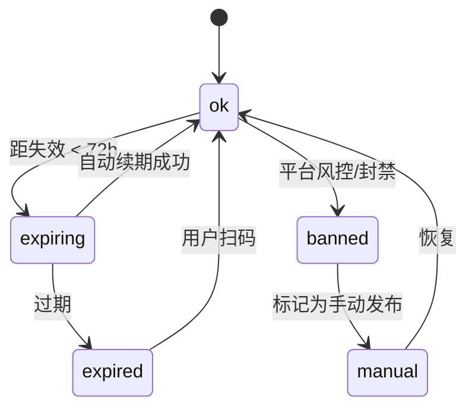
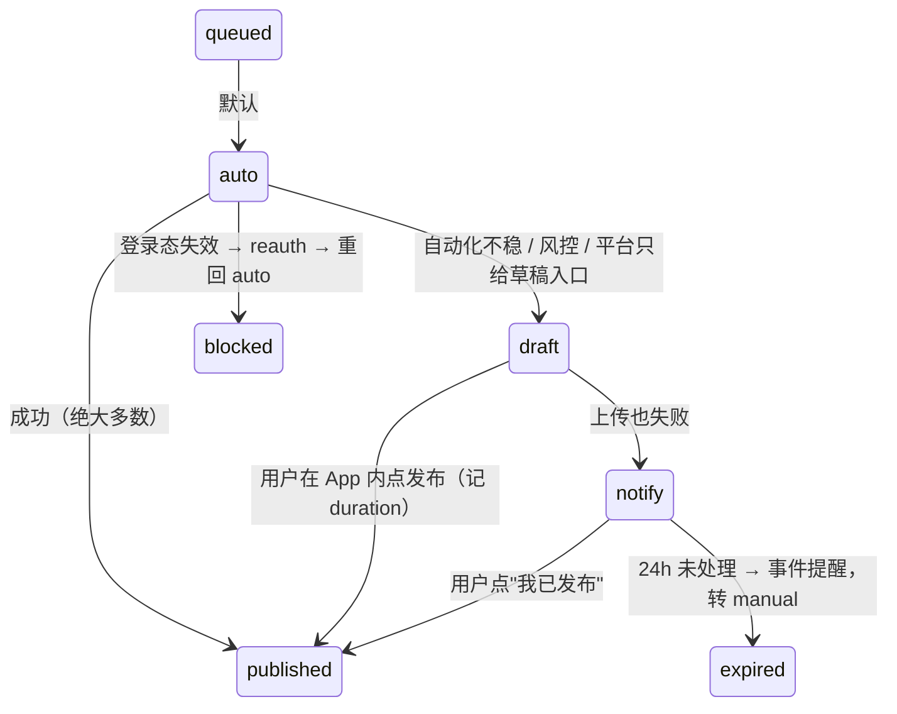

# versekit PRD

**版本** v0.1（草案）　**日期** 2026-10-27　**作者** 产品 / 与 Claude 共同整理
**状态** 待评审：需确认首批平台、控制面首通道、发布模式默认值

---

## 0. 一句话

> **versekit 是一个跑在你自己电脑上的「多平台发布 + 自有账号数据」控制面。**
> 电脑负责干活（凭证、发布、采集），手机负责拍板（通知、审批、重试）。

面向用 AI 创作的自媒体人：一条内容一次编排发到国内外多个平台，发完自动回收播放/点赞/收藏，并让创作者在手机上就能决定下一步。

---

## 1. 问题

创作者的真实一天被三件事消耗，且三件事是同一个根因的三种表现：**平台是碎片的，人是连续的。**

| JTBD | 现状痛点 | 证据 |
|---|---|---|
| **发不动** | 一条内容要手动发 6 个平台，逐个改标题/话题/封面，40 分钟；国内平台还得在 App 里发 | 现有工具只覆盖单侧（国内浏览器自动化 / 海外官方 API），无一贯通 |
| **看不见** | 发完不知道效果，各平台后台分别登录分别看，无法横向对比；数据是动态的，抓一次没有意义 | Postiz/Metricool 有分析但只覆盖海外；国内工具基本不做自家账号指标 |
| **不敢走开** | 登录态天天过期；"号掉了我不知道"；人在外面时流程卡住 | 自托管开源（Postiz/Mixpost）**全部没有移动端**；Buffer 的失败告警要靠 IFTTT 自己搭 |

**根因**：现有产品分为两类——
- **SaaS**（Buffer/Postiz Cloud/蚁小二）：移动体验天然好（因为执行在他们云上），但**凭证要交出去**，且不做国内+海外双栈；
- **自托管/桌面**（Mixpost/Postiz 自托管/命令行工具）：数据在自己手里，但**没有移动控制面**。

**"凭证留在本地" 与 "手机上随时可用" 目前没有产品同时满足。这就是 versekit 的位置。**

---

## 2. 不做什么（Anti-scope，同等重要）

| 不做 | 为什么 |
|---|---|
| 公开内容采集 / 舆情监听 | 法律风险，且是另一个独立产品（已在早期决策中排除） |
| 内容生产（写稿、出片、配音） | versekit 不生产内容，只管"出厂"和"卖得怎么样"；上游可以由视频工厂/其他 agent 提供 |
| 托管 SaaS（v0.x） | 要替用户保管第三方账号 cookie，合规与责任不可承受 |
| 团队协作 / 权限体系 | v1 前只服务 1 人管多号；多人是 v2 议题 |
| 评论回复 / 私信（Inbox） | 与"发布+数据"主线不同，容易摊薄 |
| 逆向签名接口 | 只读"用户自己登录后页面自己发出的请求"，这是开源可站住的合规边界 |

---

## 3. 用户

**P1 主力**：独立创作者 / 一人公司。1 人，3–10 个平台，2–10 个账号（含矩阵号），每天发 1–3 条，用 AI 辅助创作。
**P2**：3–8 人小工作室，需要有一个人"拍板"，其余人看数据。
**P3**：把 versekit 当 skill/MCP 接入自己 agent 流的开发者（他们贡献 star 与集成）。

**核心用户的三个特征**决定了设计：① 不在电脑前的时间远多于在电脑前；② 技术能力中等（能装 docker，不会配 tunnel）；③ 极度讨厌"登录态失效"和"发了没人告诉我"。

---

## 4. 竞争位置

```
                 移动控制面（手机可决策）
                          ▲
         Buffer/Hootsuite │  Later/Metricool
         Sprout（企业审批）│  蚁小二/易媒助手
    ──────────────────────┼──────────────────────►
     凭证在云端            │            凭证在本地
                          │
        Postiz Cloud      │  Mixpost / Postiz 自托管
                          │  social-auto-upload（纯 CLI）
                          ▼
                   无移动控制面
```

**唯一空格：右上象限 —— 凭证在你手里，同时手机上能拍板。**
（这也是本项目最该被记住的一句话。）

---

## 5. 产品架构：一个内核，三个界面

这是本 PRD 最关键的一章。**CLI / Web / 飞书不是三个产品，是同一内核的三张脸。**

### 5.1 分层

```
┌──────────────────────── 界面层（只发命令，不含业务逻辑）────────────────────────┐
│  ① CLI `vk`           ② 本地 Web（localhost:8787）   ③ 飞书/Telegram Bot 卡片  │
│  agent / 脚本 / CI        人：扫码·编排·看图表·排障        人：手机通知·审批·重试   │
└──────────────────────────────────┬────────────────────────────────────────────┘
                                   │  命令总线（command bus）
                                   │  {command_id, name, args, idempotency_key, ttl, actor}
┌──────────────────────────────────▼────────────────────────────────────────────┐
│                              versekit 内核（单进程常驻）                        │
│  命令注册表 · 任务队列 · 事件总线 · 调度器 · 状态机 · SQLite（唯一事实来源）        │
│  适配器：account / publisher / collector / channel                             │
└──────────────────────────────────┬────────────────────────────────────────────┘
                                   ▼
        平台（YouTube API / B站公开接口 / 抖音创作者中心·登录态拦截）
        本地资产（凭证、Playwright profile、视频文件）
```

### 5.2 三张脸的职责划分（不是功能重复，是人机分工）

| | **CLI `vk`** | **本地 Web** | **飞书 / Telegram** |
|---|---|---|---|
| 主用户 | agent、脚本、CI | 坐在电脑前的人 | 不在电脑前的人 |
| 典型场景 | `vk publish ./video --to all`；被 Claude Code / Codex 调用 | 扫码登录、多平台差异编排、看趋势图、看失败现场 | 收到"账号失效/发布失败/待审批"，点按钮 |
| 输出 | JSON（默认）/ `--human` | 图表 + 表单 | 卡片（标题 + 3 个按钮） |
| 是否完整能力 | ✅ **完整**（其他两端的能力必须在这里存在） | 80%（不做富文本编辑） | 20%（只做决策类动作） |
| 可否关闭 | — | 关掉不影响功能 | 关掉不影响功能 |

### 5.3 三条铁律（写进 CI 验收）

1. **CLI 完整律**：关闭 Web 与飞书后，`vk` 的功能集合不减少。反之禁止——不允许"只有网页能做的事"。
2. **语义一致律**：同一条命令在三端产生的 `command_id`、幂等键、审计记录、状态迁移完全相同。
3. **零后门律**：Web 与飞书适配器**不得**直接读写 SQLite、凭证目录、Playwright profile；只能调内核 API。

### 5.4 怎么保证三端不漂移：命令注册表（single source of truth）

每条命令**只定义一次**，其他三端自动派生：

```ts
// core/commands.ts —— 唯一真源
defineCommand({
  name: "publish.retry",
  args: { publishId: "string" },
  permission: "operator",          // 谁能远程触发
  idempotent: (a) => `retry:${a.publishId}:${attempt}`,
  ttlMs: 24 * 3600e3,              // 卡片按钮 24h 过期，防点老消息
  cli: { aliases: ["retry"], json: true },
  http: { method: "POST", path: "/api/publish/:publishId/retry" },
  card: { label: "重试", style: "primary" },   // 飞书/Telegram 按钮文案
  audit: "always",
  undo: null,                      // 能否撤销；不能撤销的必须在卡片上二次确认
});
```

**验收**：`vk commands --json` 导出的注册表 = Web 路由表 = 卡片按钮集合；三者不一致 CI 直接失败。

### 5.5 为什么飞书是"通道"而不是"存储"

上一版曾把飞书多维表格当总控台（视频工厂的做法），本项目明确**反转依赖方向**：

| | 视频工厂（自用） | versekit（产品） |
|---|---|---|
| 事实来源 | 飞书多维表格 | **本地 SQLite** |
| 飞书角色 | 数据库 + 状态机 | 视图 + 命令入口（可替换通道） |
| 飞书挂了 | 全停 | 降级为"Web/CLI 照常"，恢复后补推 |
| 换用户 | 要重建一套表 | 填一个 bot token |

---

## 6. 领域模型

```
account   1 ─── n publish          （一个账号可发多条）
work      1 ─── n publish          （一条内容发到多个账号）
publish   1 ─── n snapshot         （一条发布多次采集）
publish   1 ─── n run              （发布/采集/重授权任务）
channel   1 ─── n event_delivery   （事件投递记录，保证不漏不重）
```

| 实体 | 关键字段 | 说明 |
|---|---|---|
| `account` | platform, handle, credential_ref, **state** | `ok / expiring / expired / banned / manual`；凭证存在本地文件，DB 只存引用 |
| `work` | title, master_asset, source | 与平台无关的主素材（视频/图文） |
| `publish` | work_id, account_id, **mode**(auto/notify/manual), overrides(标题/话题/封面), scheduled_at, state, error_code | 平台差异全在这一行 |
| `snapshot` | publish_id, captured_at, **metrics(json KV)**, **source**(api/intercept/csv), **status**(ok/partial/failed) | 各平台字段不同 → 用 KV；来源与状态必须记 |
| `run` | kind, target, heartbeat_at, attempts, error | 失败是一等状态，可重排队 |
| `event` | type, severity, payload, delivered_to[] | 通知目录的落地 |

**状态机**（发布）



**账号状态机**（这是产品的"体温计"）



---

## 7. 核心流程

### 7.1 首次接入（目标：30 分钟内发出第一条）

```
vk init                          # 建库、生成配置、启动守护进程
vk account add douyin --name 主号
  → Web 自动打开扫码页（CLI 打印 localhost 链接 + 终端二维码）
  → 扫码成功 → 状态 ok → 事件 "账号已接入"
```

**产品要求**：**扫码必须落到 Web**。CLI 里贴二维码图片路径是不可接受的体验，这是 Web 存在的第一理由。

### 7.2 发布：默认全自动，四级模式（本 PRD 的核心机制）

**产品承诺：「你点一次，它就发出去」；人只在该被叫醒时被叫醒，且被叫醒时只剩一个动作。**

**前提：默认路线是「用户自己登录态的自动化」，零资质。** 不是“第三方应用获得平台授权”，而是“用户在自己的机器上、用自己已登录的会话，把重复点击自动化”。资质只属于「官方 API 路线」（可选的升级项，见 `docs/platforms.md` §3）。

| 模式 | 语义 | 人的动作 | 默认 |
|---|---|---|---|
| **`auto`** | 全自动发出去（官方 API 或浏览器自动化） | 无 | ✅ **默认** |
| **`draft`** | 自动上传 + 填文案，**投到平台草稿箱**；人在 App 里打开草稿点发布 | 打开 App → 点发布 | 自动降级的第一站 |
| `notify` | 连上传都做不了时，推通知告诉你“该发了”+ 素材位置 | 自己传 + 发 | 第二站 |
| `manual` | 只提醒，不跟踪状态 | 自行处理 | 用户显式开启 |

**为什么 `draft` 是一等模式**：上传视频是最慢、最易失败的一步（大文件 + 风控）。把它做完存进草稿箱后，手机上只剩**选封面、点发布**——不用重新传一次视频。B站、抖音、小红书、TikTok 都支持存草稿，这是比 `notify` 好得多的中间态。（源自视频工厂 `publishers/tiktok.mjs` 的注释思路："upload to inbox … the last tap is done on the phone"。）

**`notify` 的准确定义**：它**不是"让用户手动发"的发布方式**，而是自动化彻底走不通时的最后一层兜底，且**必须说明原因**。

#### 降级链路（同一个 publish 记录，不新建任务）



**设计约束（必须做）**：
1. 每次降级记录 `fallback_reason`（`flaky_automation` / `risk_control` / `no_upload_path` / `app_only_feature`），并显示在卡片上。
2. 降级率按平台统计进 `vk doctor`：**某平台长期 `draft+notify` &gt;20% 就是适配器红灯**。
3. **永不静默失败**：任何一次发布必须终结在 `published / 草稿待发 / notify待确认 / failed(带原因)` 之一。

#### 可见性策略：决策交给人，动作交给系统

读到本机工厂的 TikTok 实现（`publishers/tiktok.mjs`，151 行）后修正一个误解：**TikTok 走的是 TikTok Studio 的 web 自动化，不是 Content Posting API**。所以：

- **可见性在发布页下拉就能选**（“所有人 / 仅自己 / 好友”）——**不存在“必须先私密再手动改”的平台限制**。
- 工厂里默认发“仅自己”是**人自己的谨慎策略**（代码注释：先发私密，看一遍没问题再改公开），加 `--public` 就能一步到位。

因此 versekit 把它建模为**发布选项**，而不是“后置补救”：

| `visibility` | 行为 | 适用 |
|---|---|---|
| `public` | 发布即公开 | 信任的平台/内容（B站、YouTube、TikTok） |
| `private` | 只自己可见，不提醒 | 归档或 A/B |
| **`private_then_public`** | 先发私密 → 推卡片（附截图/链接）→ 用户点“放行” → **系统自动把可见性改成公开并核实** | AI 生成内容、需要预览一遍再放量的内容 |

> 关键区别：`private_then_public` 里**人只做决定，不做操作**。上一版我把它写成“请你去 App 里改成公开”，是把 Automation 做了一半就停——而代码里改可见性只需要一次点击，完全可以自动。

#### 后置动作（followup）：应对“上线后才发现的约束”

仍有一类问题不属于策略，而是**部分成功**：

| 场景 | 表现 |
|---|---|
| YouTube 未审核项目 | 上传成功，但被强制锁为私享（工厂已实测） |
| B站 合集 | 稿件发了，但合集要手动归入 |
| 未来：话题审核、地域限制 | 发布成功但内容不可见/不可搜 |

**处理方式**：`publish.state = published_limited` + `followup { kind, verify }`，卡片给“我已处理 / 重试”两个按钮，**系统负责核实**（YouTube `videos.list` 读 `privacyStatus`、B站读合集归属）。

三个硬要求：
1. `published_limited` 在账号墙/看板里**颜色必须与 `published` 不同**。
2. `followup` 必须可核实、可关闭，不能“记一下就当完了”。
3. 任何“上线后才发现的约束”都走 `followup`，**不再加新状态**。

#### 五个平台的能力基线（基于本机视频工厂实证）

详见 `docs/platforms.md`。关键修正：**自动化路线全部 0 资质**。

| 平台 | 默认路线 | 成熟度 | 预期降级率 |
|---|---|---|---|
| YouTube | 官方 Data API v3（本项目唯一走官方 API 的平台） | 🟢 已跑通 | <2%（注意未审核项目会被强制私享） |
| B站 | biliup + 用户自己的 cookie | 🟢 已跑通 | 5–8% |
| 小红书 | 创作服务平台发布页自动化 | 🟢 已跑通（单账号） | 10–20% |
| 抖音 | 创作者中心自动化（待建，参考 social-auto-upload） | 🟡 待建 | 8–15% |
| TikTok | **TikTok Studio web 自动化**（已验证，工厂 151 行）；API 是备选 | 🟢 已跑通 | 5–10%（可见性是选项，不是障碍） |

> 只有 YouTube 需要开发者侧配置（OAuth 客户端），但它也不需要"资质"；因此 **v0.1 可以零资质交付**。

### 7.3 采集（动态指标 = 打快照）

```
发布后：+1h, +6h, +24h, +3d, +7d, 之后每天
每条快照记录 (作品, 平台, 时间, 指标 KV, source, status)
```
- **前密后疏**：发布初期曲线价值最高。
- **必须记 `source` 与 `status`**：用户要能分辨"3 天前抓的"和"登录过期没抓到"。
- **采集失败 ≠ 静默**：连续 2 次失败 → 事件 `collect.degraded` → 推卡片。

### 7.4 远程审批与控制（飞书/Telegram）

```
内核事件 → 通道适配器 → 卡片（标题 + 上下文 + ≤3 按钮）
用户点按钮 → 命令总线（带 command_id / 幂等键 / TTL / actor）
→ 白名单校验 → 执行 → 回写结果到同一条卡片（编辑原消息，不刷屏）
```

**通知目录**（事件 → 是否必推）

| 事件 | 级别 | 卡片按钮 | 备注 |
|---|---|---|---|
| `account.expiring` / `account.expired` | **必推** | 查看看法 / 重新授权 / 该号转手动 | 最高价值：提前知道 vs 发布时才发现 |
| `publish.failed` | **必推** | 重试 / 转 notify / 看现场 | 按平台聚合成一条 |
| `publish.needs_human` | **必推** | 打开 App / 我已发布 / 稍后 | notify 模式主路径 |
| `publish.needs_followup` | **必推** | 我已设为公开（→ 系统核实） | 部分成功：可见性/合集/话题待补 |
| `approval.requested`（可选门禁） | **必推** | 发布 / 打回（附理由） | 工作室场景 |
| `collect.degraded` | **必推** | 重试 / 转手动 / 看现场 | 接口改版/风控的第一信号 |
| `metric.milestone` | 可配 | 看趋势 | 情绪价值 |
| `digest.daily` | 可配（9:00） | 打开看板 | 替代"每天登 6 个后台" |
| `system.dead`（守护进程离线） | **必推** | 重启 / 看日志 | 否则整套悄无声息地死掉 |

**规则**：合并投递（一条消息 ≤3 个事件）、带时序、去重 id、敏感信息（凭证/绝对路径）永不出现在卡片里。

### 7.5 失效自愈

```
采集/发布报 auth_error
  → account.state = expired
  → 该账号所有队列任务暂停（不反复失败、不触发风控）
  → 事件 account.expired（卡片：请到电脑扫码）
  → 用户扫码 → 队列自动恢复
```
**明确承认的限制**：扫码必须在那台电脑前（同机扫自己没有可靠路径）。远程通道的职责是**提前告警**，不是假装能远程解决。这句话要写进文档，比吹"全流程移动化"更值得信任。

---

## 8. 功能需求

### 平台范围（首批 5 个，分两波交付）

**排序原则：先接"本机已跑通"的，把内核与降级机制验证透；新建魔板放第二波。**

| 波次 | 平台 | 理由 |
|---|---|---|
| **Wave 1** | YouTube · B站 · 小红书 · TikTok | 四个都已在工厂跑通（TikTok 上传通道通，仅可见性需后置动作）；先验证“发布 + 降级 + followup + 快照”四条主链 |
| **Wave 2** | 抖音 | 唯一从零建的适配器（参考 social-auto-upload 的 `douyin_uploader`） |

### P0（v0.1–v0.2 交付）

| ID | 需求 | 验收标准 |
|---|---|---|
| F1 | 账号接入与状态机 | 每平台可添加/查看/重授权/删除；状态变更产生事件；失败有可读原因 |
| F2 | 多平台发布（auto + notify） | 一条 work 发到 ≥3 平台；每平台可覆盖标题/话题/封面/可见性/定时；结果逐平台可见 |
| F3 | 快照采集 | 播放/点赞/收藏三指标落库；记录 source/status；采集节奏前密后疏 |
| F4 | 账号墙（Web） | 一屏看到所有账号登录态、最近发布、最近采集；一键重授权 |
| F5 | 作品详情（Web） | 三指标趋势图 + 采集来源与时间戳 + 跨平台并排 |
| F6 | 通知通道（飞书或 Telegram 至少一个） | 6 类必推事件可投递；卡片按钮可执行对应命令并回写结果 |
| F7 | 命令注册表 + 三端派生 | `vk commands --json` 与 Web 路由、卡片按钮一致（CI 校验） |
| F8 | 任务队列与重试 | 任务有心跳/超时/重试上限；失败可单条重试；进程重启后队列不丢 |

### P1（v0.3–v0.4）

| ID | 需求 | 验收标准 |
|---|---|---|
| F9 | 总览看板 | 跨账号/平台/时间聚合趋势；可按平台切分 |
| F10 | CSV 手工导入 | 无接口平台可导入指标，与自动采集同构入库（source=csv） |
| F11 | Skill / MCP 封装 | `vk` 能力以 skill + MCP 双形态暴露；agent 可完成"发布→看数据"闭环 |
| F12 | 飞书多维表格适配器 | 双向同步（DB→表、表按钮→命令），断开不影响内核 |
| F13 | 第二个通知通道 | Telegram 与飞书并存，可按事件选择通道 |
| F14 | 矩阵批量 | 批量改标题/批量定时/批量发布 |

### P2（v1.0+）

托管与团队、评论 Inbox、竞品对标、AI 选题建议（用自家数据反推选题）。

---

## 9. 关键产品决策

| 决策 | 选择 | 理由 |
|---|---|---|
| 执行位置 | **本地优先** | 凭证与视频在本地；托管=替用户保管 cookie，合规不可承受 |
| 控制面主形态 | **IM 卡片**（飞书优先，Telegram 并存） | 零网络配置（出网轮询）、自带推送、自带按钮、手机原生、无需上线 App |
| 自动化 vs 官方 API | **自动化优先，官方 API 作为可选升级** | 自动化零资质、能力全（封面/话题/位置），且已在本机工厂跑通；官方 API 只用于自动化覆盖不到的能力（如 YouTube 播放列表、TikTok 直接发布） |
| 资质 | **v0.1 零资质交付** | 资质只属于官方 API 路线，不应阻塞产品启动 |
| 指标存储 | **KV + source/status** | 平台字段天然不同；用固定宽表会立刻崩 |
| 采集合规边界 | 只读"自己登录后页面自己发出的请求"，不逆向签名 | 开源可站住的唯一边界，也是我们的护城河 |
| Web 的定位 | **只做"必须用眼睛/必须扫码"的 5 个页面** | 控制体量，保持一天能重构 |
| 飞书的定位 | **可替换通道**，不是存储 | 让"飞书挂了产品不死"成为架构事实 |

---

## 10. 非功能需求

- **安全**：凭证文件 0600；bot token 只存本地；卡片不含凭证/路径；远程命令白名单 + 24h TTL + 全量审计。
- **隐私**：不发遥测（或 opt-in 且只发聚合计数）；数据永不出本机（除平台自身请求）。
- **韧性**：守护进程崩溃自动拉起；队列持久化；单账号故障不阻塞其他账号。
- **可观测**：`vk doctor` 输出账号健康、通道连通、最近失败、下次采集时间；一份日志文件 + 结构化事件。
- **性能**：1000 条 publish / 50 万条 snapshot 下单作品详情 <300ms；24 平台并行采集不互相阻塞。
- **可移植**：macOS/Linux 优先（Windows 在 v1 后），单二进制或 `npx` 起步。

---

## 11. 指标

**北极星**：每周成功发布的 `publish` 数（含 notify 模式确认数）。

| 指标 | 目标 |
|---|---|
| 首次价值时长（安装 → 第一条发布） | < 30 分钟 |
| 一条内容发 6 平台耗时 | < 2 分钟（含差异编排） |
| 账号失效能被主动发现的比率 | 100%（不允许用户自己在后台发现） |
| 通知卡片动作完成率 | > 60%（说明卡片在解决真实决策） |
| 静默失败（无事件）次数 | 0 —— 反指标，出现即 P0 缺陷 |

---

## 12. 路线图

| 版本 | 内容 | 出门条件 |
|---|---|---|
| **v0.1** | 内核 + CLI + SQLite + Wave 1 三平台（YouTube/B站/小红书）login/publish/collect + 账号墙 + **auto→draft→notify 降级链路** | 三平台各自动发出至少 1 条；断网/失败时能正确降级并说明原因；`vk doctor` 全绿 |
| **v0.2** | Web 5 页 + 事件目录 + **飞书通道** + reauth 闭环 | 手机收到"账号失效/需确认"卡片，点按钮后内核状态正确变化 |
| **v0.3** | 看板 + CSV 导入 + 命令注册表 CI 校验 + **Wave 2（抖音/TikTok）** | 三端一致性测试通过；5 平台均可发布 |
| **v0.4** | Skill/MCP + 飞书多维表格适配器（Telegram 延后） | agent 独立完成一次发布并回报 |
| **v1.0** | 文档站 + 一键安装 + 能力矩阵 + 首个外部用户 | 外部用户 30min 内完成首次发布 |

---

## 13. 风险与待决策

| 风险 | 应对 |
|---|---|
| 国内平台改版/风控导致采集失效 | 能力分级（API→拦截→CSV 手工）+ `collect.degraded` 事件 + 平台适配器独立发布 |
| 通知噪音导致用户关闭 | 合并投递、必推白名单（6 类）、默认静音非关键事件 |
| 三端漂移 | 命令注册表 + CI 一致性校验（§5.4） |
| 维护 N 个平台适配器 | 社区化：适配器独立包 + 契约测试夹具 |

**已定（2026-10-27）**
1. 首批平台：YouTube、B站、抖音、小红书、TikTok（Wave 1/2 见 §8）。
2. 控制面：**先只做飞书**，Telegram 延后到 v0.4 之后。
3. 发布模式：**默认 `auto`**，`notify` 为自动兜底，`manual` 需用户显式开启。

**仍待确认**
1. **TikTok 是否并行提交 App 审核**：审核前的代价是每发一条都要手动改公开（`followup`）；审核通过后就彻底自动。建议提交，但不阻塞开发。
2. **抖音适配器**：从零写（参考 social-auto-upload 的 `douyin_uploader`）还是先 graft 一份再重构？
3. **小红书风险容忍度**：接受 10–20% 降级，还是限制该平台只做单账号低频（不做矩阵）？

---

## 14. 附录

### 14.1 竞品证据（2026-10 调研）

| 产品 | 移动端 | 推送 | 失败告警 | 远程审批 |
|---|---|---|---|---|
| Buffer | 官方 App（2025 重做 iOS） | ✅ | ❌ 需 IFTTT/Zapier + Slack | ❌ |
| Later | 官方 App | ✅ | ⚠️ 有"未收到通知"排障文档 | ❌ |
| Hootsuite | 官方 App | ✅ | ⚠️ 邮件/仪表盘 | 部分 |
| Sprout Social | 官方 App | ✅ | ⚠️ | ✅（含 Mobile Publisher 角色） |
| Postiz（OSS） | ❌ 第三方 Postio | ❌ 仅邮件 | ❌ | ❌ |
| Mixpost（OSS） | ❌ 无 | ❌ 邮件 | ❌ | ❌ 仅网页 |
| Gain（审批） | Web+聊天 | ✅ | ✅ | ✅ 主打签核 |
| 蚁小二 / 易媒助手 | ✅ App | ✅ | 未知 | ❌（批量分发非审批） |
| **versekit** | **IM 卡片 + 本地 Web** | **✅ 出网轮询** | **✅ 一等事件** | **✅ 卡片审批** |

### 14.2 术语

- **执行面**：持有凭证与资产、真正调平台的本地进程。
- **控制面**：接收事件、发起命令的界面（Web / IM 卡片 / CLI）。
- **notify 模式**：由人完成平台侧最后一步、系统只跟踪状态的发布模式。
- **命令总线**：三端共用的命令通道，负责幂等、TTL、白名单、审计。
